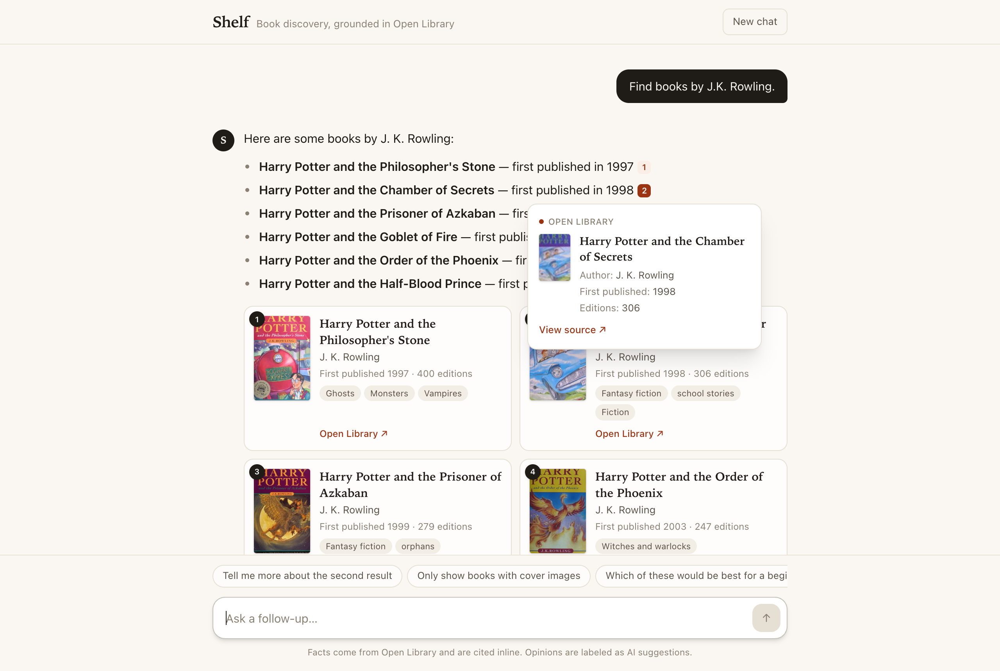

# Shelf — AI Book Discovery Chatbot

A conversational book-discovery app. Ask about authors, titles and topics; answers are grounded in **Open Library** data, every fact carries an **inline citation** with a hover/click preview, and AI opinions are clearly labeled as suggestions.



**Live demo:** https://book-discovery-chatbot.vercel.app

**Submission summary** (what was built, priorities, limitations, time spent, AI tools): [SUMMARY.md](SUMMARY.md)

**Stack:** Next.js 16 (App Router) · TypeScript · Tailwind CSS 4 · OpenAI Chat Completions (tool calling, streaming) · Open Library API (Apple Books as a backup) · Vitest

---

## Run locally

Requires **Node.js 20.9+** (Next.js 16 requirement; an `.nvmrc` is included, so `nvm use` works).

```bash
git clone https://github.com/jayukani1996/book-discovery-chatbot.git && cd book-discovery-chatbot
npm install
cp .env.example .env.local        # then put your key in OPENAI_API_KEY
npm run dev                       # http://localhost:3000
```

| Variable | Required | Default | Notes |
|---|---|---|---|
| `OPENAI_API_KEY` | yes | — | Server-side only; never sent to the browser. |
| `OPENLIBRARY_CONTACT` | no | — | Email or URL added to the User-Agent sent to Open Library, which asks API clients to identify themselves. Recommended for a deployed demo. |
| `RATE_LIMIT_PER_MINUTE` | no | `20` | Per-IP request limit for `/api/chat`, which protects the key on a public demo link. |
| `OPENAI_MODEL` | no | `gpt-5.4-mini` | Any Chat Completions model with tool calling. If the key can't access the configured model, the app falls back to `gpt-4.1-mini` automatically. |

Other scripts:

```bash
npm test          # 77 unit + agent-loop tests (no network, no API key needed)
npm run eval      # live evaluation: required + adversarial scenarios against a running app (needs the key)
npm run lint      # TypeScript type-check
npm run build && npm start   # production build
```

### Deploy (Vercel)
Import the repo in Vercel → add `OPENAI_API_KEY` under *Environment Variables*, plus `OPENLIBRARY_CONTACT` (recommended) and optionally `OPENAI_MODEL` → Deploy. No other configuration needed.

---

## How it works

```
Browser (React)                         Next.js route  /api/chat                 External
───────────────                         ──────────────────────────               ────────
messages + source registry  ──POST──▶   agent loop (max 6 rounds)
                                          │  OpenAI (stream, tools) ◀──────────▶ OpenAI
                                          │   ├─ search_books      ───────────▶ openlibrary.org/search.json
                                          │   ├─ get_book_details  ───────────▶ openlibrary.org/works/{id}.json
                                          │   └─ show_books (chooses cards)
        ◀── NDJSON stream: status · sources · text deltas · books · error · done
```

1. **Tools, not memory.** The model has three tools: `search_books` (author/title/subject/free-text, sort, cover filter), `get_book_details` (description, subjects, first-publication date) and `show_books` (which cards to render, in order). The system prompt forbids stating any title/author/date/fact that didn't come from a tool result.
2. **Source registry.** Every Open Library work retrieved gets a stable conversation-scoped id (`S1`, `S2`…), deduplicated by work key. The model cites ids like `[S3]`; it never writes URLs — links are built server-side from the work key.
3. **Citation rendering.** The client renumbers ids per message (`[1]`, `[2]`…) in order of appearance, drops any id that isn't in the registry (so an invented source can't render), and shows a popover with source name, title, author, first-published date, editions, a description snippet and a **View source ↗** link.
4. **Follow-ups.** The client keeps the transcript and the registry (persisted in `localStorage`). Each prior assistant turn is replayed to the model followed by a separate app note listing the exact cards the user saw — `1. S4 "…" — author (year), cover: yes` — so "the second result", "the author of the first one" and "only ones with covers" resolve against what was on screen. (It is a separate system note rather than appended text, so the model doesn't copy it into answers.)
5. **Facts vs opinions.** Recommendations go under **Recommendation (AI suggestion):** and state what they're based on ("based on the Open Library descriptions — not a ranking by sales or reviews"). Questions the data can't answer (sales, ratings, prices) get an explicit "I don't have enough information from the available Open Library data…".
6. **Guardrails in code, not just the prompt.** If the model writes a preamble and then decides to call more tools, that text is discarded (a `reset` stream event) so answers are never duplicated. If it forgets `show_books`, the cards fall back to the records it cited, or to the previous list on a cover filter. If Open Library can't be reached and the answer has no sourced facts, the app replaces it with its own error card and **Try again**, so an outage can never produce an answer from memory. An echoed internal note is stripped before rendering.
7. **Reliability.** Open Library calls have a 9 s timeout, one retry and a 10-minute in-memory cache; failures are returned to the model as tool errors so it tells the user instead of guessing. OpenAI errors (bad key, quota, model not found, network) map to readable messages with a **Try again** button. Cards/popovers render cleanly with missing covers, authors, years or descriptions.

### Project layout

```
src/
  app/api/chat/route.ts    request validation (zod), NDJSON streaming, error mapping
  lib/agent.ts             tool-calling loop, history building, guardrails
  lib/tools.ts             tool schemas + execution
  lib/openlibrary.ts       Open Library client (timeouts, retry, cache, normalization)
  lib/postWithRetry.ts     retries a request once if the connection drops
  lib/applebooks.ts        Apple Books backup, used only when Open Library refuses
  lib/sources.ts           conversation source registry (stable S# ids)
  lib/citations.ts         citation parsing / validation / renumbering
  lib/prompt.ts            system prompt (grounding, citation, recommendation rules)
  components/              Chat shell, message renderer, citation popover, book cards
tests/                     Vitest: citations, Open Library and Apple Books clients, agent loop (fake OpenAI + fixtures)
```

## Required test scenarios

| Scenario | What happens |
|---|---|
| *Find books by J.K. Rowling.* | `search_books(author, sort=editions)` → cards + cited summary |
| *Find introductory books about artificial intelligence.* | free-text search ("introduction to artificial intelligence") → details for top hits → cited list, "introductory" judgment labeled as AI suggestion |
| *Who wrote Kindred and when was it first published?* | title search (+ details) → "Octavia E. Butler … 1979 [1]" |
| *Only show books with cover images.* | filters the last multi-book result list via `has_cover`, re-renders cards, says how many were removed (or that all already have covers) |
| *Tell me more about the second result.* | resolves #2 from the displayed list → `get_book_details` → description/subjects with citations |
| *Recommend three books about startups for a beginner.* | search + details → three cards, recommendation section clearly labeled |
| *Which of these books sold the most copies last year?* | "I don't have enough information from the available Open Library data to determine…"; offers what the data does contain |

All scenarios above, plus the other example questions from the brief ("Show me more books by the author of the second result", "Tell me more about the first book", "Which of these would be best for a beginner?", "When was The Left Hand of Darkness first published?"), were run end-to-end against the live OpenAI API and Open Library. I also checked that no answer cited an unknown id or contained a model-written URL, that citations sat inline, and that recommendations carried the label. `gpt-5.4-mini` was picked as the default after comparing it with `gpt-4.1-mini` and `gpt-4.1` on this run. The smaller/older models sometimes skipped citations or the recommendation label.

## Testing

| Layer | Command | What it covers |
|---|---|---|
| Unit / agent | `npm test` | Citation parsing and renumbering, invented-id dropping, Open Library normalization, the agent loop with a fake OpenAI client, the guardrails (preamble reset, card fallback, tampered-record rejection), the rate limiter |
| Live eval | `npm run dev` then `npm run eval` | 18 turns: the 7 required scenarios plus adversarial ones (pressure to fabricate, prompt injection, impossible ordinals, no results, off-topic), with invariants checked on every turn. Exits non-zero on failure, so it can gate prompt or model changes. Pass a URL to evaluate a deployment: `node scripts/eval.mjs https://…` |

### Book data sources
Open Library is the main source. If it refuses a request or can't be reached, searches switch to the Apple Books Search API (no key needed) and the app stops calling Open Library for 60 seconds. When a search only finds nothing, it does not switch. Apple's records are labelled wherever they appear: on the card, in the citation preview and in a note under the answer.

Apple's catalog lists ebooks, so its date is that ebook's release date. The app keeps it apart from first publication: *Kindred* shows "Ebook released 1997", and the bot says Apple doesn't have the original publication date rather than giving a year from memory. If both sources are down, the user sees an error card with a Try again button.

### Open Library etiquette
Open Library is a free, volunteer-run service with anti-bot protection. The app caches responses for 10 minutes, spaces requests about 350 ms apart, backs off before its single retry, and never retries when Open Library signals rate limiting (a 429 or a redirect to its `verify_human` page). If Open Library can't be reached, the app uses its backup source, and the bot never answers from memory. Running `npm run eval` many times in a row can get your IP refused by Open Library for a while; searches then use Apple Books until the block clears. Apple refuses bursts too (roughly 20 requests a minute), so `npm run eval` spaces its turns 6 seconds apart (`EVAL_GAP_MS`).

## Security notes
- The API key lives only in server env vars; `.env*` is git-ignored. Verified absent from the client bundle.
- `/api/chat` is rate-limited per IP (default 20/min) so a public demo link can't drain the key.
- Book records the client sends back are revalidated: work keys must match `/works/OL…W`, and links are rebuilt server-side, never trusted from the client.
- Request bodies are validated and size-capped; Open Library links are generated from work keys, never from model output; markdown links in answers open in a new tab with `rel="noopener noreferrer"`.
